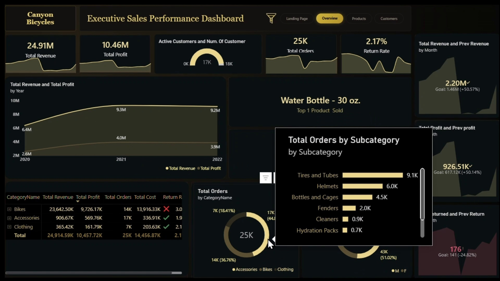
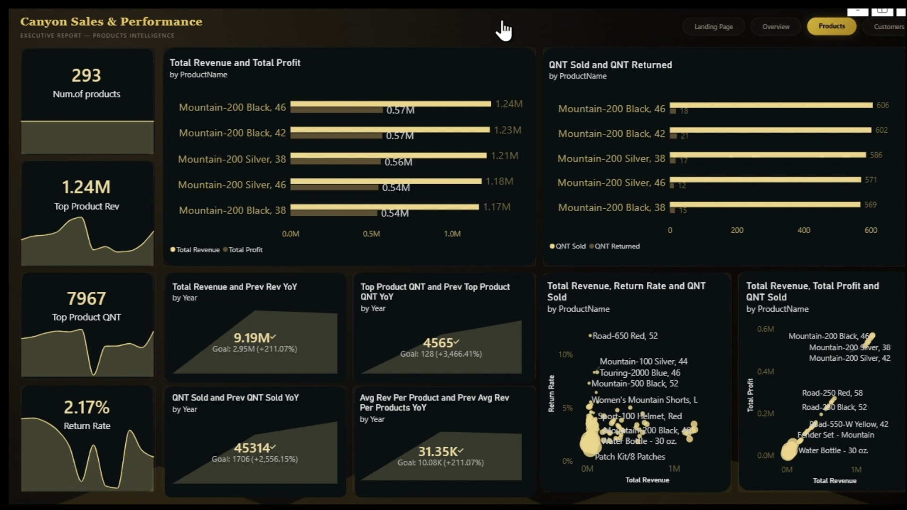
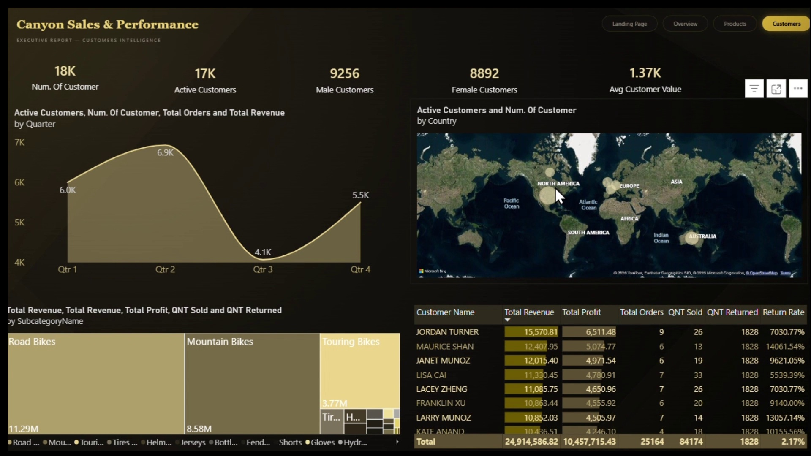
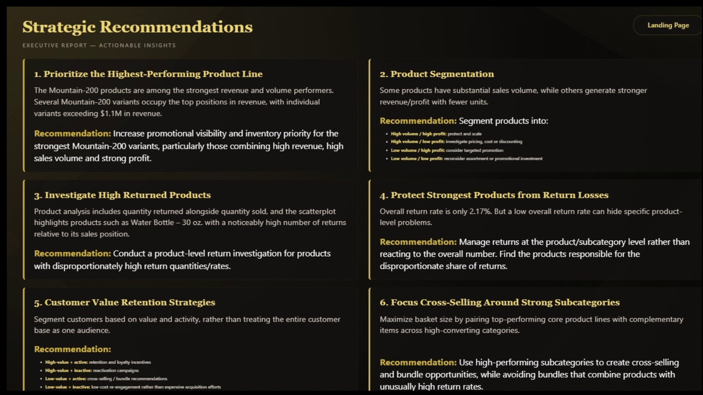

# Canyon Bikes — Executive Sales Performance Analysis

**Tools:** Microsoft Power BI, Power Query, DAX  
**Project Type:** Interactive Business Intelligence Report  
**Dataset:** Simulated business data

## Project Overview

Developed a multi-page, interactive Power BI report to evaluate Canyon Bikes' sales performance, profitability, product performance, customer behavior, and return trends. The report was designed to help executives explore business performance from different perspectives and make informed, data-driven decisions.

## Report Preview

| Executive Overview | Product Analysis |
|:---:|:---:|
|  |  |
| Customer Analysis | Recommendations |
|  |  |

[View the custom landing-page screenshot](landing-page.jpg)

## Report Structure

- **Executive Overview:** Presents key performance indicators, revenue and profit trends over time, quantity sold by gender, orders by product category, and product return patterns.
- **Product Analysis:** Examines revenue and profit across products, highlights the top five products, and compares quantities sold with quantities returned.
- **Customer Analysis:** Explores active and inactive customers, customer distribution by gender, and average customer value.
- **Recommendations:** Presents actionable recommendations based on product profitability, returns, customer retention, and cross-selling opportunities.
- **Custom Landing Page:** Provides a dedicated navigation page to improve the report's visual presentation and user experience.

## Key Analytical Findings

- **Product Performance:** The Mountain 200 product line stood out for its strong revenue and sales volume, making it a candidate for greater promotional visibility and inventory priority.
- **Product Returns:** A leading product by sales volume also recorded the highest number of returned units, highlighting the need to investigate potential product or customer-expectation issues.
- **Product Profitability:** Products differed in sales volume and profitability, suggesting that inventory and product strategies should account for both metrics rather than sales volume alone.
- **Customer Retention:** Customer analysis highlighted the importance of distinguishing active customers from inactive customers, particularly when identifying previously high-value customers who may be worth re-engaging.
- **Cross-Selling Opportunities:** Strong-performing product subcategories presented opportunities to pair complementary products into bundles.

## Recommendations

1. **Prioritize top-performing products:** Improve promotional visibility and maintain appropriate inventory levels for leading products.
2. **Segment products by volume and profitability:** Group products into high-volume/high-profit, high-volume/low-profit, low-volume/high-profit, and low-volume/low-profit segments to support better product and inventory decisions.
3. **Investigate high-return products:** Examine products with unusually high return counts or rates to identify possible quality, product-description, or customer-expectation issues.
4. **Monitor returns at the product level:** Investigate the products and subcategories contributing to returns rather than relying exclusively on the overall return rate.
5. **Re-engage valuable inactive customers:** Consider targeted offers and second-purchase incentives to encourage previously high-value customers to return.
6. **Explore cross-selling opportunities:** Bundle complementary products around strong-performing subcategories to encourage additional purchases.

## Technical Skills Demonstrated

- Data cleaning and preparation using Power Query
- DAX measures and KPI calculations
- Data modeling and relationships between tables
- Time-based performance analysis
- Interactive data visualization and multi-page report design
- Product, customer, and return analysis
- Business recommendations and analytical storytelling

## Explore the Project

- **[Open the Power BI report](https://app.powerbi.com/groups/me/reports/74afff9f-2f8b-46b9-bb01-39f9d262bcbf/99a8f5386bea473023e2?experience=power-bi)** 
- **[Download the interactive Power BI file (.pbix)](Canyon.pbix)** 
- **[Open the project walkthrough video](Final%20Report%20-%20Canyon%20Project.mp4)** 

## Project Reflection

This project strengthened my ability to transform business requirements into an interactive business intelligence report. It provided practical experience with Power Query, DAX, data modeling, and multi-page report design while developing my ability to translate analytical findings into actionable business recommendations.

## About Me

**Claudia Al-Amir** | Data Analyst  
[LinkedIn](https://www.linkedin.com/in/claudia-al-amir-131199424) · [Email](mailto:claudiaalamir21@gmail.com)
